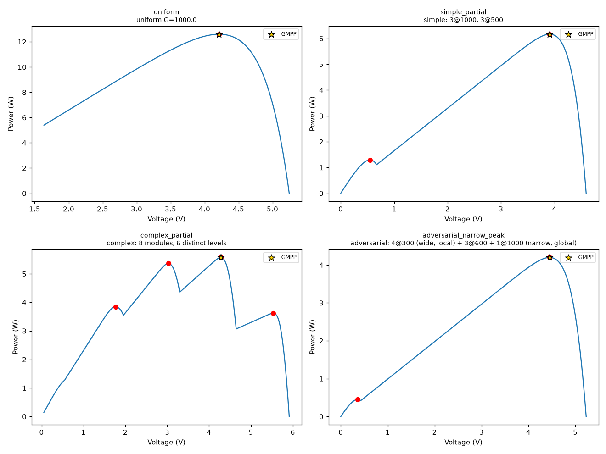
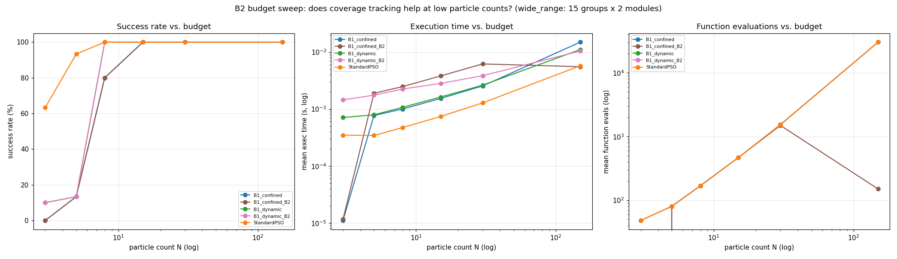

# Clustering-Based PSO for Global MPPT of Partially Shaded PV Strings

**A reproducible research codebase for PSOMbest (Twumasi et al., 2024) and the B1/B2 clustering variants developed in this project.**

This repository contains the complete implementation and experimental evidence for a family of particle-swarm optimisation (PSO) algorithms applied to the global maximum power point tracking (GMPPT) problem in partially shaded photovoltaic (PV) strings. It includes:

- A **line-by-line Python reproduction** of the paper's MATLAB master driver (`PSOMbest_Main_Master.m`), with five benchmark algorithms (PSO, PSO-AWDV, PSOEA, GA, PSOMbest) and 22 benchmark cases.
- **B1**, a family of frozen-grouping PSO variants that replace PSOMbest's per-iteration k-means with a one-off grouping and a fading cluster pull.
- **B2**, a coverage-based (tabu-style) mechanism that detects when a voltage region has been fully explored and either freezes its particles (confined variant) or drops its stale leader signal (dynamic variant).
- A **synthetic PV string testbed** built on the Bishop diode model, with four reproducible partial-shading scenarios and independent ground truth.
- Nine **controlled experiments** covering paper reproduction, shifted-optimum robustness, ablation, leader isolation, timing/resource cost, and scalar-leader effects.



*The four preset partial-shading scenarios produced by the PV testbed, with ground-truth peaks (red) and the global maximum (gold star). The adversarial case has a narrow global peak beside a wide local one.*

---

## Table of contents

- [Headline findings](#headline-findings)
- [Repository map](#repository-map)
- [Algorithms at a glance](#algorithms-at-a-glance)
- [Quick start](#quick-start)
- [Running the experiments](#running-the-experiments)
- [Results snapshot](#results-snapshot)
- [Reproducibility notes](#reproducibility-notes)
- [References](#references)
- [License and citation](#license-and-citation)

---

## Headline findings

> All numbers below come from the result files checked into this repository. See [docs/03_results.md](docs/03_results.md) for the full tables and caveats.

| Finding | Evidence |
|---|---|
| The Master-code reproduction is statistically close to the paper for PSO, PSO-AWDV and PSOEA, but **not for PSOMbest** (5/19 cases within 10× of the published MAE). | `experiments/01_toe_to_toe_50runs/tables.md` |
| **B1-fade, B1-coord-fade and B1-proj-fade beat the reproduced PSOMbest on MAE in 11 of 19 cases** (8 significant at rank-sum *p* < 0.05) while being **roughly 12–19× faster per run in the vectorised runner**. They still lose to plain PSO on most cases, so B1 is a *specialist* improvement over PSOMbest, not a universal winner. (The speed ratio mixes synchronous and particle-by-particle implementations; experiment 05 gives implementation-matched timing.) | `experiments/01_toe_to_toe_50runs/tables.md` |
| In the Master-loop implementation, PSOMbest costs **1.36× PSO wall time**; B1-fade **1.21×**, B1-coord-fade **1.25×**, B1-proj-fade **1.14×**. PSOMbest spends ~1 s per run on k-means alone at 1000 iterations. | `experiments/05_timing_and_resources/summary.txt` |
| **B2 coverage freezing cuts evaluations by 99.5%** in the confined variant (30,150 → 150 on the full suite) while keeping 100% GMPP success; voltage error rises only slightly (≤ 0.064 V). The dynamic variant, as designed, saves *no* evaluations — its effect is on accuracy only. | `variants/b2_coverage/results_b2_full_suite.csv` |
| In the PV testbed, B1 achieves **100% success at 0 V error** across uniform, simple, complex, and adversarial narrow-peak scenarios (30 seeds each). This run used B1 in isolation with no baseline comparison. | `variants/b1_baseline/report_b1.md` |
| The PSOMbest scalar leader helps on the original benchmarks but **collapses when the optimum is shifted** so that coordinates differ; vector leaders (especially `stored_best`) are much more robust. | `experiments/07_leader_isolation/merged_leader.csv` |

---

## Repository map

```text
pso-mppt-research/
├── README.md                     ← you are here
├── requirements.txt
├── LICENSE
├── CITATION.cff
│
├── reference/                    Paper reproduction (MATLAB master driver → Python)
│   ├── psombest_main_master_python_corrected.py
│   ├── benchmarks/
│   │   ├── optimizers_fast.py    Vectorised PSO / PSOMbest / B1-dynamic
│   │   └── optimizers_variants.py Experimental grouping variants + extra metrics
│   └── README.md
│
├── pv_testbed/                   Synthetic PV string simulator
│   ├── pv_model.py               Bishop model + bypass-diode string logic
│   ├── scenarios.py              uniform / simple / complex / adversarial / random
│   ├── verify.py                 Physical sanity checks + reference plot
│   └── README.md
│
├── variants/
│   ├── b1_baseline/              B1 static confined clustering + evaluation harness
│   └── b2_coverage/              Coverage tracking (B2) for confined and dynamic B1
│
├── experiments/                  Self-contained, restart-safe experiment bundles
│   ├── 00_version_comparison/    Early port-versus-version comparison
│   ├── 01_toe_to_toe_50runs/     Head-to-head vs the paper, 10 algorithms, 50 runs
│   ├── 02_shifted_optimum/       Shifted-optimum robustness test
│   ├── 03_b1_master_loop/        B1 variants inside the Master PSO loop
│   ├── 04_b1_regrouping/         B1 with regrouping at iterations 300–700
│   ├── 05_timing_and_resources/  Wall/CPU time, memory, grouping microbenchmarks
│   ├── 06_ablation/              Which PSOMbest features help B1-proj-fade?
│   ├── 07_leader_isolation/      Scalar vs vector group leaders, original vs shifted
│   └── 08_scalar_leader/         One-number leader applied to all B1 variants
│
└── docs/
    ├── 01_algorithms.md          Equations and design rationale
    ├── 02_experiments.md         Experiment catalogue and run recipes
    ├── 03_results.md             Results snapshot and interpretation
    └── 04_reproducibility.md     Parity fixes, deviations, and limitations
```

Each experiment folder is **self-contained**: it carries its own `ports.py` snapshot so it runs without importing from another folder. Result CSVs and analysis tables produced by the experiments are kept alongside the code.

---

## Algorithms at a glance

| Name | Grouping | Group pull | Velocity memory | Notes |
|---|---|---|---|---|
| **PSO** | none | none | yes | Classical PSO (Master-file port) |
| **PSO-AWDV** | none | none | yes + delay term | Adaptive inertia, time-varying `c1`/`c2` (Xu et al., 2021) |
| **PSOEA** | none | none | yes | Evolutionary (rank-selected crossover) start, then PSO |
| **GA** | none | none | — | Real-coded GA: rank selection, arithmetic crossover, cooled Gaussian mutation |
| **PSOMbest** | k-means **every iteration** (warm start) | cluster leader | discarded after each move in the Master code | Third attraction term `c3` |
| **B1-fade** | k-means **once**, frozen centroids | best personal best in group | kept | `c3` fades linearly 1 → 0 |
| **B1-coord-fade** | per-coordinate quantile cuts, frozen | per-coordinate group leader | kept | High-dimensional grouping |
| **B1-proj-fade** | first principal axis cut into k intervals, frozen | best personal best in interval | kept | Cheapest grouping step |
| **B2 (confined)** | B1 confined regions | freezes exhausted regions | — | Saves function evaluations |
| **B2 (dynamic)** | B1 dynamic membership | drops leader pull in exhausted regions | — | No eval savings; accuracy effect only |

Full update equations and design notes: [docs/01_algorithms.md](docs/01_algorithms.md).

---

## Quick start

### Requirements

- **Python 3.10+** (tested on 3.14)
- `numpy`, `scipy`, `pandas`, `matplotlib`, `openpyxl`, `tabulate`
- Optional: `psutil` (Windows timing test)

```bash
git clone https://github.com/Archangel15/pso-mppt-clustering.git
cd pso-mppt-clustering
python -m venv .venv
# Windows: .venv\Scripts\activate
# Linux/macOS: source .venv/bin/activate
pip install -r requirements.txt
```

### 1. Verify the PV testbed

```bash
cd pv_testbed
python verify.py
```

This prints peak counts and GMPP locations for every scenario and regenerates `verify_scenarios.png`. It is the first thing to run after changing `pv_model.py`.

### 2. Run the PSOMbest reproduction driver

```bash
cd reference
python psombest_main_master_python_corrected.py --mode debug     # quick smoke test (~1 min)
python psombest_main_master_python_corrected.py --mode sample    # 9 cases, 10 runs
python psombest_main_master_python_corrected.py --mode full --workers 8
```

Outputs are written to `PSOMbest_Python_Reproduction_Results/` (Excel workbook, `.npz` raw data, convergence figures, log). The full mode is 22 cases × 5 algorithms × 50 runs × 150 particles × 1000 iterations — plan for a long run and multiple workers.

### 3. Run one of the experiment bundles

Every experiment follows the same pattern: start `N_WORKERS` processes, each with a different worker ID, then merge.

```bash
cd experiments/01_toe_to_toe_50runs
python run_all.py 0 8 50
python run_all.py 1 8 50
# ... through worker 7 (one terminal per worker)
python analyze.py
```

The runners are **restart-safe**: existing `results_*.csv` rows are skipped, so an interrupted run resumes where it stopped. See each folder's `README.md` for its exact scale and outputs.

---

## Running the experiments

| # | Folder | Question | Scale | Entry points |
|---|---|---|---|---|
| 00 | `00_version_comparison` | Do the supplied PSOMbest versions (`fixed`, `master_*`) differ, and does the early in-house version match? | 22 cases × 7 versions × `RUNS` | `run_all.py`, `analyse.py` |
| 01 | `01_toe_to_toe_50runs` | Head-to-head against Twumasi et al. with 10 algorithms | 22 × 10 × 50 = 11,000 runs | `run_all.py`, `analyze.py` |
| 02 | `02_shifted_optimum` | Do results survive moving each optimum to a different value per coordinate? | 10 × 6 × 30 = 1,800 | `run_all.py`, `merge.py` |
| 03 | `03_b1_master_loop` | How do B1 variants perform inside the Master PSO loop? | 22 × 3 × 50 = 3,300 | `run_all.py`, `merge.py` |
| 04 | `04_b1_regrouping` | Does rebuilding groups at iterations 300–700 help? | 19 × 3 × 50 = 2,850 | `run_all.py`, `merge.py` |
| 05 | `05_timing_and_resources` | Wall/CPU time, memory, and grouping-only cost | 6 cases × 6 algos × 3 reps + microbenchmarks | `timing_test.py` |
| 06 | `06_ablation` | Which PSOMbest features help B1-proj-fade? | 6 configs × 10 × 2 × 30 = 3,600 | `run_all.py`, `merge.py`, `selftest.py` |
| 07 | `07_leader_isolation` | Is PSOMbest's lead caused by its one-number leader? | 6 rules × 10 × 2 × 30 = 3,600 | `run_all.py`, `merge.py`, `selftest.py` |
| 08 | `08_scalar_leader` | What happens when B1 gets the PSOMbest scalar leader? | 9 × 19 × 50 + 9 × 10 × 30 = 11,250 | `run_all.py`, `merge.py`, `analyse.py`, `selftest.py` |

Full commands, expected runtimes, and output descriptions: [docs/02_experiments.md](docs/02_experiments.md).

---

## Results snapshot

### Paper reproduction (50 runs, 22 cases, Master-code port)

Reproduction count = re-run MAE within 10× of the published MAE in either direction (19 cases; F18 excluded because it duplicates F4):

| Algorithm | Cases reproduced |
|---|---|
| PSO | 17 / 19 |
| PSO-AWDV | 16 / 19 |
| PSOEA | 17 / 19 |
| GA | 9 / 19 |
| PSOMbest (Master code) | 5 / 19 |

The PSOMbest discrepancy is not a crash: it is dominated by the high-dimensional and noisy cases, and is consistent with the random-stream difference between MATLAB's `rng('twister')` and NumPy's MT19937 plus the literal `VelMax = 1 × range` setting. See [docs/04_reproducibility.md](docs/04_reproducibility.md).

### B1 vs PSOMbest (same 19 cases, by MAE)

| B1 variant | Wins | Losses | Ties | Significantly better |
|---|---|---|---|---|
| B1-fade | 11 | 6 | 2 | 8 |
| B1-coord-fade | 11 | 6 | 2 | 8 |
| B1-proj-fade | 11 | 6 | 2 | 7 |

### Timing (median wall time, 6 representative cases, 1000 iterations)

| Algorithm | Ratio to PSO | k-means calls / run |
|---|---|---|
| PSO | 1.00× | 0 |
| PSOMbest (Master code) | 1.36× | 1000 |
| PSOMbest + velocity memory | 1.27× | 1000 |
| B1-fade | 1.21× | 0 |
| B1-coord-fade | 1.25× | 0 |
| B1-proj-fade | 1.14× | 0 |

### B2 coverage freezing (full PV suite, 30 seeds per scenario)

| Algorithm | Mean evaluations | Mean voltage error | Success |
|---|---|---|---|
| B1_confined | 30,150 | ~0 V | 100% |
| **B1_confined_B2** | **150** | 0.007–0.064 V | 100% |
| B1_dynamic | 30,150 | ~0 V | 100% |
| B1_dynamic_B2 | 30,150 | 0.007–0.048 V | 100% |
| P&O | 501 | 0.02–4.31 V | 13–100% |
| Standard PSO | 30,150 | ~0 V | 100% |

The confined B2 result is the strongest compute story in the project: once every 0.3 V bin in a region has been visited, freezing its captive particles means almost no further evaluations are spent, yet the GMPP is still found. The dynamic B2 variant intentionally does not freeze anything, so its evaluation count is unchanged.



*B2 budget sweep on a wide-range 15-group × 2-module scenario: success rate, execution time, and function evaluations as the particle budget grows. Freezing pays off once the initial coverage sweep can exhaust a region early.*

---

## Reproducibility notes

- **MATLAB parity, not bit-identity.** The reproduction uses `numpy.random.RandomState` (MT19937). MATLAB's `rng(seed,'twister')` is the same generator family but not a bit-identical stream. Compare statistically, not run-by-run.
- **Four corrections** were made after a line-by-line comparison with `PSOMbest_Main_Master.m`: the LHS index offset, inertia/`c1`/`c2` update timing in PSO-AWDV, the initial k-means label vector, and MATLAB rounding for GA elitism. Details in [docs/04_reproducibility.md](docs/04_reproducibility.md).
- **Documented deviation:** the reference `psokmeans.m` uses `VelMax = 1 × (VarMax − VarMin)`. The vectorised benchmark code uses `0.1 × range`, the standard PSO convention, because the literal value causes severe overshoot (e.g. 30-D Zakharov mean error drops from 52.5 to 9.4e-8 at 0.1×). This is deliberate and flagged in the module docstring.
- **Missing B1 baseline module.** `variants/b1_baseline/run_b1_experiments.py` imports `b1_static_confined_pso.py`, which was not present in the source snapshot. The report, harness and run script are included; add that module to re-run the baseline harness. The B2 code is self-contained and does not depend on it.
- **Results are checked in.** Raw/merged CSVs for each experiment are included so every table can be regenerated or audited without re-running the sweeps. Runner CSVs are written to the experiment's working directory.

---

## References

1. Twumasi et al. (2024). **PSOMbest** — the clustering-based PSO source paper and its `PSOMbest_Main_Master.m` / `psokmeans.m` implementations.
2. Mao, M., Zhang, L., Duan, Q., Duan, P., Yang, L. (2018). *Grid-connected modular PV-converter system with shuffled frog leaping algorithm based DMPPT controller.* **Energy** 143, 181–190. (Bishop-model parameters and PV testbed equations.)
3. Xu et al. (2021). PSO with adaptive weighted delay velocity (PSO-AWDV).
4. Eberhart, R. C., & Shi, Y. (2000). *Comparing inertia weights and constriction factors in particle swarm optimization.* (Velocity-limit convention.)

---

## License and citation

Released under the MIT License — see [LICENSE](LICENSE).

If you use this code, please cite the repository via [CITATION.cff](CITATION.cff) and cite the original PSOMbest and PV-model papers above.
